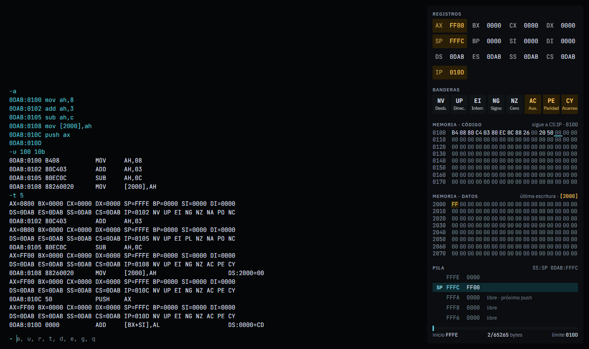

# DEBUG 8086

Simulador web del DEBUG de MS-DOS: escribe instrucciones assembler 8086, ejecútalas paso a paso y observa cómo cambian los registros, las banderas, la memoria y la pila.



## Qué es

Reproduce el programa `DEBUG` de MS-DOS tal como se comporta dentro de DOSBox, para practicar assembler sin instalar nada. Se usa igual que el original: se escriben comandos de una letra en una terminal y las respuestas tienen el mismo formato.

Junto a la terminal, un panel muestra el estado de la máquina después de cada comando:

- **Registros y banderas**, con lo que cambió en el último comando resaltado en ámbar.
- **Memoria de código**, que sigue a `CS:IP` y marca la instrucción que se ejecuta a continuación.
- **Memoria de datos**, que salta a la última dirección escrita por el programa.
- **Pila**, con la posición de `SP`, las palabras apiladas y las posiciones libres.

En el móvil el panel se divide en pestañas; en tableta se muestra como una franja sobre la terminal.

## Comandos

| Comando | Qué hace |
|---|---|
| `a [dirección]` | Ensambla instrucciones línea por línea. Una línea vacía termina. |
| `u [rango]` | Desensambla la memoria. |
| `r [registro]` | Muestra los registros, o cambia el valor de uno. |
| `t [=dirección] [cantidad]` | Ejecuta una instrucción (o varias) y muestra los registros. |
| `g [=dirección]` | Ejecuta hasta que el programa termina. |
| `d [rango]` | Muestra la memoria en hexadecimal y ASCII. |
| `e dirección [lista]` | Escribe bytes o cadenas en memoria. |
| `q` | Reinicia la máquina y limpia la terminal. |

Todos los números son hexadecimales. Un rango es `inicio fin` o `inicio L longitud`, y una dirección puede llevar segmento (`cs:100`).

## Ejemplo

Un programa que imprime un saludo siete veces:

```
-a 100
jmp 130

-e 102 "que tengas un feliz dia!" 0d 0a "$"
-a 130
mov bx,7
mov dx,102
mov ah,9
int 21
dec bx
jnz 138
int 20

-g
```

Para verlo instrucción por instrucción, usa `t` en lugar de `g`.

## Qué simula

- El juego de instrucciones completo del 8086: transferencia, aritmética, lógica, desplazamientos, cadenas con `REP`, saltos, llamadas, pila, interrupciones y prefijos de segmento.
- Las mismas codificaciones que elige DEBUG al ensamblar (`mov ax,8` → `B8 08 00`).
- Los servicios de DOS más usados: `INT 20`, `INT 21` con las funciones `02`, `09` y `4C`, y el error de división (`Divide overflow`).

Diferencias con el DEBUG real:

- `q` reinicia la sesión en lugar de cerrar el programa.
- `t` sobre un `INT` resuelve la interrupción completa en un solo paso.
- `g` se detiene tras 1.000.000 de instrucciones, para no congelar la pestaña.
- No hay comandos de archivos ni de disco (`n`, `l`, `w`), ni `f`, `m`, `c`, `s`, `h` o `p`.
- La máquina arranca con los valores de una sesión concreta de DOSBox: segmento `073F`, `SP=00FD` y el PSP que deja DOS. El resto de la memoria arranca en cero, así que lo que haya más allá del programa puede no coincidir con el de otro equipo.

## Desarrollo

Requiere Node 24 y pnpm.

```bash
pnpm install
pnpm dev      # servidor de desarrollo
pnpm test     # tests (Vitest)
pnpm build    # compilación de producción en dist/
pnpm lint
```

Hecho con React 19, TypeScript, Vite y el React Compiler. La lógica del simulador no depende de React y se puede usar sola desde Node.

```
src/
  debug/   lógica del simulador, un módulo por archivo con sus tests
           hex → state → memory → flags → decoder → disassembler
           → executor → dos → assembler → commands → view → session
  ui/      componentes de la interfaz y estilos
docs/      especificación original y diseño de referencia
```

La interfaz y la lógica se comunican solo a través de `src/debug/types.ts`: la lógica produce un `DebugView` después de cada línea, y la interfaz lo dibuja.

## Licencia

Copyright (C) 2026 Mikell Bobadila

Este proyecto se distribuye bajo la [GNU Affero General Public License v3.0](LICENSE) (AGPL-3.0-only). Puedes usarlo, modificarlo y redistribuirlo, pero cualquier versión modificada, incluida una que se ofrezca como servicio web, debe publicarse con su código fuente bajo la misma licencia.

Si quieres usarlo bajo otras condiciones, por ejemplo en un producto cerrado, escríbeme para hablar de una licencia comercial.
